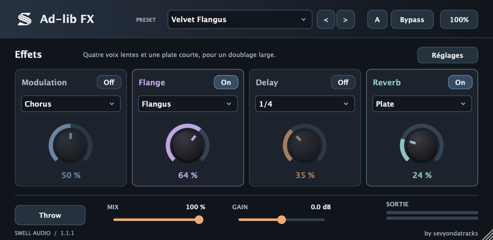
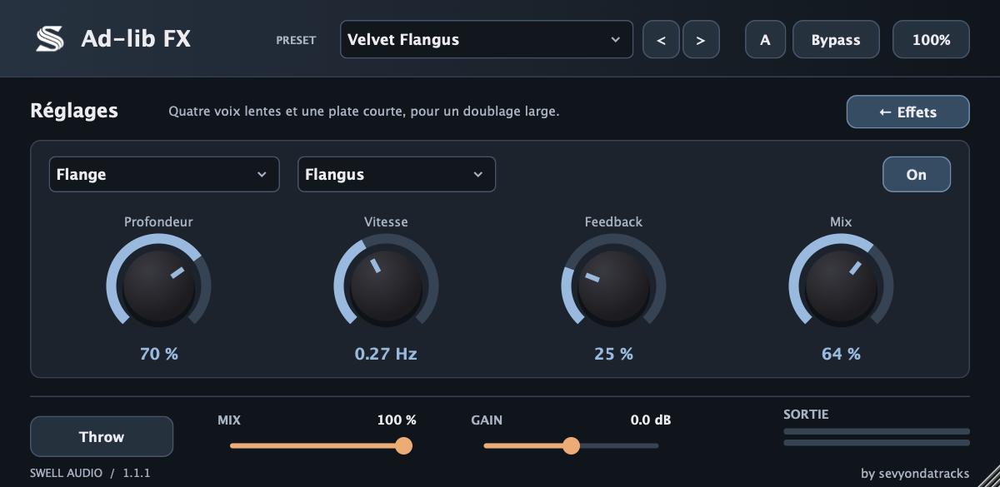

<p align="center">
  
</p>

<h1 align="center">Swell Ad-lib FX</h1>

<p align="center">
  Le tout-en-un pour les effets créatifs de la voix et des ad-libs — <b>Standalone</b>, <b>VST3</b> (Windows / Mac) et <b>AU</b> (Mac)<br>
  par <b>Swell-audio</b> · <a href="https://github.com/sevYOnDaTracks">@sevyondatracks</a>
</p>

---

## Le principe

Dans FL Studio, charge **Swell Ad-lib FX** sur la piste de mixage de ta voix. Choisis un preset dans le menu en haut. Les quatre dosages pilotent la modulation, le flanger, le delay et la reverb. Active un effet en tournant son bouton ou en choisissant son mode. **Réglages** donne accès aux paramètres de chaque effet et aux macros voix.

## La chaîne d'effets

La voix traverse huit effets dans l’ordre du tableau. Le chorus et le flanger disposent chacun de leur interrupteur et peuvent être superposés.

<p align="center">
  
</p>

| Effet | Modes | Réglages |
|---|---|---|
| **CLEAN** | High-pass, Low-pass, Band-pass | coupe basses, coupe aigus, de-esser |
| **PUNCH** (compresseur) | Smooth, Punchy, Smash | quantité, attaque, volume |
| **PITCH** | -12, -7, +7, +12 demi-tons, Libre | transposition, mix, réglage fin |
| **COLOR** | Tape, Warm, Fuzz, Crush, Phone, Radio, Megaphone | drive, tone, mix |
| **MOD** | Doubler, Chorus, Wide | profondeur, vitesse, mix |
| **FLANGE** | Flanger, Flangus à quatre voix | profondeur, vitesse, feedback, mix |
| **DELAY** | 1/4, 1/8, 1/16, 1/4 pointée, Ping-pong | feedback, tone, mix, ducking |
| **REVERB** | Room, Plate, Hall, Dark, Reverse | taille, pre-delay, mix, ducking |

## Les macros de la vue Réglages

| Macro | Action |
|---|---|
| **SPACE** | quantité de delay + reverb |
| **DIRT** | saturation (module COLOR) |
| **PITCH** | transposition de -12 à +12 demi-tons (module PITCH) |
| **WIDTH** | largeur stéréo (0 = mono, 50 % = d'origine, 100 % = très large) |

Le ducking baisse les répétitions ou la reverb pendant la voix. Les fins de phrase retrouvent leur place quand la voix s’arrête.

## Sortie

- **THROW** : le delay ne part que sur la fin des mots (parfait pour les « yeah », « skrt »…).
- **MIX** : dosage voix d'origine / voix traitée.
- **GAIN** : volume de sortie.
- **A / B** : compare deux réglages. **BYPASS** : coupe tous les effets.

## Presets

23 presets en quatre catégories (Trap, R&B, Rage et FX). Les 17 presets existants gardent leurs index. Six nouveaux sons sont disponibles dans la version 1.1.0.

| Preset | À écouter |
|---|---|
| Velvet Flangus | Quatre voix lentes et une plate courte pour doubler un ad-lib R&B. |
| Jet Sweep | Balayage métallique lent, feedback marqué et saturation tape. |
| Last Word | La dernière syllabe revient en ping-pong au tempo de la session. |
| Soft Focus | Chorus stéréo et hall qui s’efface pendant le chant. |
| Prism Stack | Chorus et Flangus en série, suivis d’un écho court. |
| Low Orbit | Doublure à l’octave grave, flanger discret et delay en croche. |

## Compiler

**Windows** (Visual Studio 2022 Build Tools + CMake) :

```powershell
.\build.ps1
```

**Mac** (Xcode command line tools + CMake) :

```bash
./build-mac.sh
```

Le delay suit le tempo du DAW (120 BPM en standalone).
